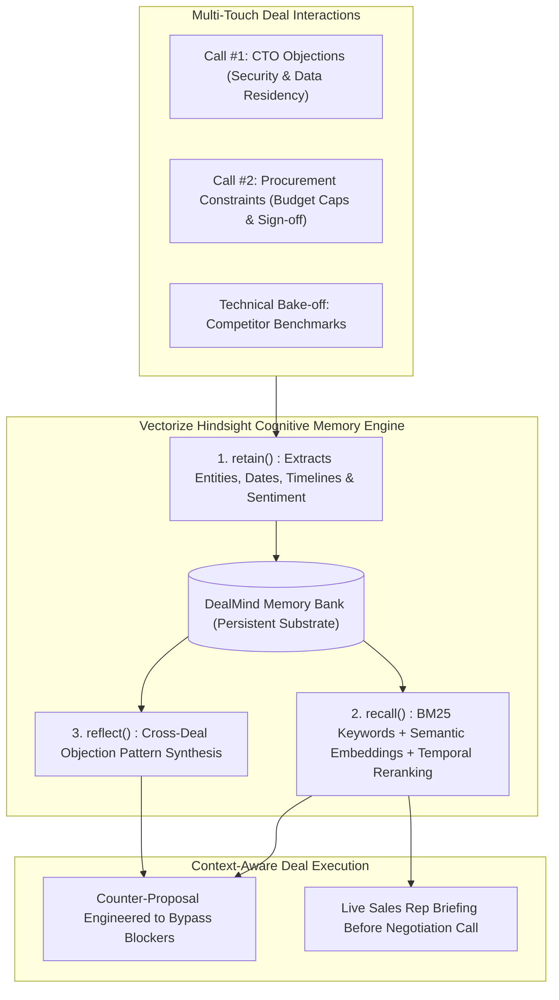

# DealMind: Autonomous Enterprise Deal & Objection Intelligence

> Autonomous B2B sales intelligence agent powered by **[Vectorize Hindsight](https://github.com/vectorize-io/hindsight)** long-term persistent memory.

[](https://hindsight.vectorize.io/)
[](https://fastapi.tiangolo.com)
[](https://opensource.org/licenses/MIT)

---

## 🎯 The Core Problem: Agent Amnesia in Complex Deals

In high-stakes enterprise sales, deals span across 3–9 months, 10+ calls, and multiple stakeholders (CTO, Head of Procurement, Security Architect). 

Standard AI agents and stateless LLMs suffer from **catastrophic conversational amnesia**:
- They treat call #5 as if it were call #1.
- They repeatedly quote multi-tenant public cloud pricing to clients who previously mandated on-prem/VPC due to regulatory compliance (e.g., RBI or HIPAA).
- They pitch contracts above procurement sign-off caps, causing months of administrative delays.

Traditional vector databases (RAG) fail because they treat text as unstructured chunks, ignoring **temporal timelines**, **entity relationships**, and **evolving human objections**.

---

## 🧠 The Solution: Long-Term Memory with Hindsight

**DealMind** bridges this gap using **[Vectorize Hindsight](https://github.com/vectorize-io/hindsight)** as a structured cognitive memory substrate:



### Key Memory Operations:
1. **`retain()`**: Ingests unstructured call notes and audio transcripts, automatically resolving stakeholders, entities, and objection categories.
2. **`recall()`**: During call preparation, executes reciprocal rank fusion (BM25 keyword search + semantic embeddings) filtered by account and date.
3. **`reflect()`**: Synthesizes cross-deal patterns (e.g., *"67% of enterprise FinTech deals stall if single-tenant VPC is not pitched in call #1"*).

---

## 🚀 Quick Start & Installation

### 1. Clone the Repository
```bash
git clone https://github.com/vibudhisainikhil9-beep/dealmind.git
cd dealmind
```

### 2. Install Dependencies
```bash
pip install -r requirements.txt
```

### 3. Environment Configuration
Create a `.env` file or export your credentials:
```bash
export HINDSIGHT_API_KEY="your_vectorize_hindsight_api_key"
export HINDSIGHT_BASE_URL="https://api.hindsight.vectorize.io"
```
*(Note: If running offline or without an active key, DealMind gracefully falls back to its built-in local memory engine so live demonstrations never crash.)*

### 4. Run the Server
```bash
python main.py
```
Open your browser and navigate to:
```
http://localhost:8000
```

---

## 📊 Live Demonstration Flow

1. **Shock-and-Awe Simulation:** Click **"Run Live Call Simulation"** to view side-by-side responses:
   - **Stateless Agent:** Quotes $65k ARR and pitches multitenant cloud, violating both procurement cap and security requirements.
   - **DealMind Agent:** Automatically recalls memories `mem-101` (RBI mandate) and `mem-102` (Neha's $45k cap) to pitch a compliant Mumbai VPC at $44,500, accelerating deal close by 45 days.
2. **Recall Engine Playground:** Search queries like *"What compliance objections did FinTech Corp raise?"* and observe ranked confidence scores and extracted entities.
3. **Cross-Deal Reflection Dashboard:** View high-level synthesized insights derived from multiple deal retrospectives.

---

## 🛠️ Tech Stack & Integrations

- **Long-Term Memory Substrate:** [Vectorize Hindsight](https://github.com/vectorize-io/hindsight)
- **API Engine:** Python 3.11, FastAPI, Uvicorn, Pydantic v2
- **Agent Desktop Integration:** [Band AI Desktop](https://www.band.ai)
- **Client Dashboard:** Tailwind CSS, Alpine.js, FontAwesome

---

## 🔗 Official References & Deep Dives

- [Hindsight GitHub Repository](https://github.com/vectorize-io/hindsight)
- [Hindsight Official Documentation](https://hindsight.vectorize.io/)
- [Understanding Agent Memory - Vectorize](https://vectorize.io/what-is-agent-memory)

---

## 📄 License
MIT License. Built by **Team CoreStack** (Vibudhi Sainikhil, Tech Lead).
